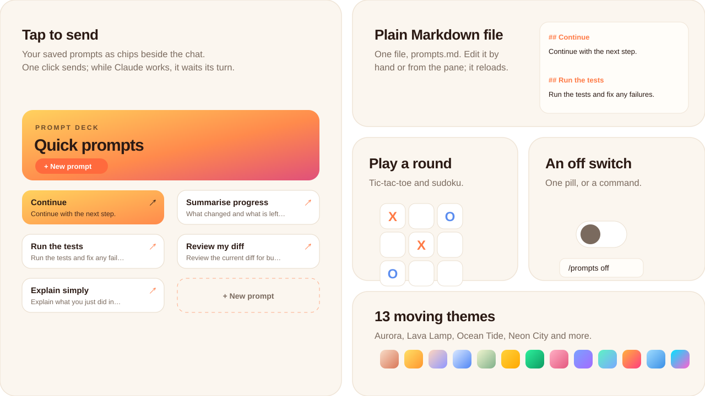

<p align="center">
  
</p>

<p align="center">
  &nbsp;
  <a href="LICENSE"></a>&nbsp;
  
</p>

<p align="center">
  <b>A pane beside the chat in the Claude desktop app</b> that holds the prompts you keep retyping.<br>
  Tap one and it is sent. Play a round while Claude works. Restyle the whole app with a moving theme.
</p>

<br>

<picture>
  <source media="(prefers-color-scheme: dark)" srcset="docs/features-dark.svg">
  
</picture>

## Install

**In the Claude desktop app:** click **+** next to the prompt box, then **Plugins**, **Add marketplace**, enter `Nishant2116/prompt-deck`, and **Add plugin**.

**At the prompt of a terminal session:**

```
/plugin install prompt-deck --marketplace Nishant2116/prompt-deck
```

Answer `y` to add the marketplace, then press Enter for the user scope.

**From a shell:**

```bash
claude plugin install prompt-deck --marketplace Nishant2116/prompt-deck
```

The pane opens in every new session. In a session that was already open, run `/reload-plugins`.

## Themes that move

<p align="center">
  
</p>

Each theme sets the app's colors for light and dark mode, its message bubbles, and a slow scene behind the chat that the panels frost over. The pane's header plays the same scene. Pick one in the gallery at the bottom of the pane, or step through them with the theme pill in the header. Motion stops when your system asks for reduced motion, and your pick carries over to new sessions.

## Your prompts, in a plain file

```markdown
## Continue

Continue with the next step.

## Run the tests

Run the tests and fix any failures.
```

They live in `~/.claude/prompt-deck/prompts.md`. Each `## Title` line starts a prompt, and everything under it, up to the next `## ` line, is the text that gets sent, across as many lines as you like. Add, edit and delete from the pane (**+ New prompt**, or **•••** on a chip) or in any editor: the pane picks up changes within a few seconds. Text above the first heading is kept as notes, a `## ` inside a code fence stays part of its prompt, and deleting the file brings back the five starters.

While Claude is busy, a tapped prompt waits and sends when the turn ends.

## Play while Claude works

One card, two games. **Tic-tac-toe** against Claude, which looks ahead to the end of every game and never loses (a draw is a good result), and a **4×4 sudoku** with a number pad and clashes in red. The round **⇄** button swaps them with a wave of light across the new board; every move glints, and Claude's reply lands a beat after yours.

## Turning it off

- **For now:** press **Off** in the pane's header, or type `/prompts off`. The pane closes, Claude's own look comes back, and new sessions stay quiet. Type `/prompts on` (or just `/prompts`) to bring it back.
- **Settings:** two switches in Claude's plugin settings (the `/config` menu in a terminal session): **Open Prompt Deck when a session starts** and **Let Prompt Deck theme the app**.
- **The whole plugin:** turn it off in Claude's Plugins screen, or from a shell:

  ```bash
  claude plugin disable prompt-deck@prompt-deck
  ```

  `claude plugin enable prompt-deck@prompt-deck` turns it back on, and `claude plugin uninstall prompt-deck@prompt-deck` removes it.

<details>
<summary><b>Where it works</b></summary>

<br>

The widget and themes draw in the Claude desktop app's Code tab. A terminal session's fullscreen layout and the phone apps show the same prompts as plain buttons, without the games or themes.

</details>

<details>
<summary><b>Develop</b></summary>

<br>

```bash
git clone https://github.com/Nishant2116/prompt-deck.git
cd prompt-deck
claude plugin validate .
claude plugin test .
claude --plugin-dir .
```

The pane is a set of Client regions sized in text lines (`hooks/tile.tsx`, `game.tsx`, `gallery.tsx`, `pills.tsx`) over SVG art pinned to each tile (`hooks/art.ts`, `scenes.ts`). Prompts are sent with `$.prompt.submit`, falling back to `$.prompt.fill`.

</details>

## License

MIT
